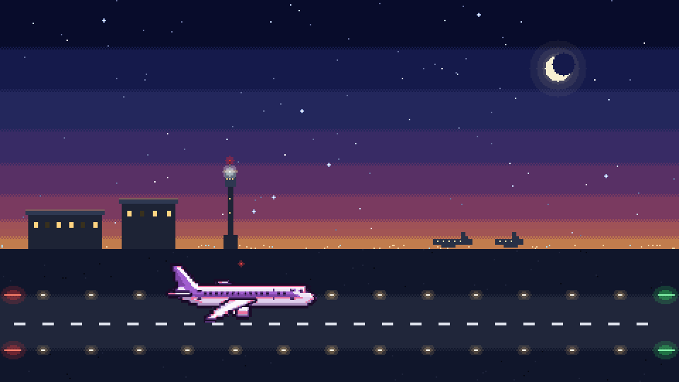
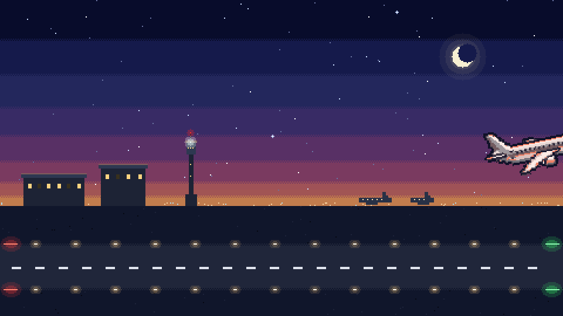
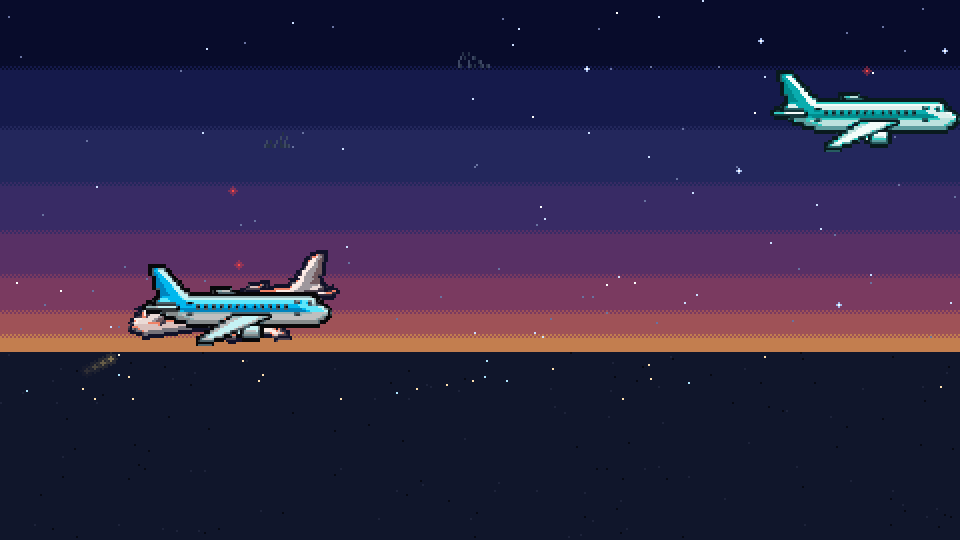

# ✈️ airport-saver

Un économiseur d'écran macOS en pixel art : un aéroport de nuit où des avions
atterrissent, roulent, se garent et redécollent — et qui **traverse tes écrans**.
Sur un setup multi-moniteurs, un avion qui décolle sort de l'écran principal et
continue son vol sur les écrans voisins, à cheval sur le bezel, sans coupure.



## Ce que ça fait

- **Écran principal** — l'aéroport : ciel dégradé nuit (bandes dithered), lune,
  étoiles qui scintillent, hangars et tour de contrôle éclairés, piste avec feux
  lumineux et seuils rouge/vert. Le trafic est vivant : les avions **entrent en
  roulant depuis le bord de l'écran**, s'alignent, décollent ; les arrivées
  descendent en plané, touchent, freinent, se garent 6 secondes puis roulent
  hors champ. Jamais d'apparition/disparition sèche.
- **Écrans secondaires** — le ciel : même dégradé (aligné au pixel près avec le
  principal), nuages qui dérivent, avions en transit avec feux de navigation et
  phare d'atterrissage.
- **Continuité multi-écrans** — un `FlightCoordinator` partagé lit la disposition
  physique réelle des moniteurs et relaie chaque avion d'écran en écran au moment
  où son nez touche le bord : les deux écrans le dessinent simultanément pendant
  la traversée. Le sens des décollages suit tes écrans (moniteur à gauche →
  décollage vers la gauche).
- **La flotte** — sprites pixel art extraits automatiquement de références
  d'images (pipeline grille + palette) : deux airliners de base, une version
  courte régionale, une allongée long-courrier, six livrées, et des variantes
  inclinées montée/descente générées par rotation de grille.

|                                       |                                   |
| ------------------------------------- | --------------------------------- |
|  |  |

## Installation

```bash
make install   # build + copie dans ~/Library/Screen Savers + rechargement
```

Puis **Réglages Système → Économiseur d'écran → airport-saver**.
Pour le lancer tout de suite : `make run`.

## Développement

```bash
make build     # compile le .saver (Debug)
make check     # checks CLI : topologie écrans + machine à états piste
make render    # rend une frame de la scène dans /tmp/airport.png et l'ouvre
```

Le projet a un principe central : **tout se vérifie à l'œil, sans écran de
veille**. Le harnais `checks/render.swift` compile en CLI et rend n'importe
quelle scène en PNG à un instant donné :

```bash
/tmp/render airport out.png 480 12    # scène aéroport, largeur 480, t=12s
/tmp/render sky out.png 645 8         # scène ciel, largeur ultra-wide
/tmp/render takeoff out.png 480 16    # décollage forcé à t=0 (déterministe)
```

La logique pure (`RunwayPlane`, `ScreenTopology`) n'importe pas AppKit et se
teste par des checks `swiftc` autonomes (`checks/*.swift`).

## Architecture (5 minutes)

```
AirportSaverView   une instance par écran ; route vers la bonne scène
PixelCanvas        buffer logique (hauteur fixe 270, largeur au ratio de
                   l'écran), y vers le bas, blit nearest-neighbor
AirportScene       scène principale : décor + trafic piste
RunwayPlane        machine à états pure (approche → freinage → parking →
                   taxi-out / taxi-in → alignement → décollage → montée) ;
                   coordonnées natives, le sens est un miroir au dessin
SkyScene           scène ciel des écrans secondaires
FlightCoordinator  singleton : topologie des écrans, choix du côté de sortie
                   par vol, relais des avions aux bords (nez sur le bord →
                   spawn simultané sur l'écran voisin)
Sprites            sprites grille+palette (avions), rasterizer ASCII (nuages),
                   rotation de grille pour les inclinaisons
```

## Crédits

Références visuelles des avions fournies par Ethan (pixel art converti en
grilles par pipeline d'extraction). Développé en pair avec Claude Code —
chaque étape visuelle validée sur rendus PNG.
